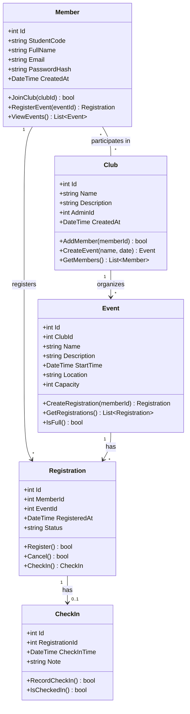

# Class Diagram – EduHub

## Giải thích khóa và quan hệ

### 1. Khóa chính (PK) và khóa ngoại (FK)

| Class | Khóa chính (PK) | Khóa ngoại (FK) |
|---|---|---|
| `Member` | `Id` | Không có |
| `Club` | `Id` | `AdminId` → `Member.Id` |
| `Event` | `Id` | `ClubId` → `Club.Id` |
| `Registration` | `Id` | `MemberId` → `Member.Id`; `EventId` → `Event.Id` |
| `CheckIn` | `Id` | `RegistrationId` → `Registration.Id` |

### 2. Bội số quan hệ

- `Member * — * Club`: Một thành viên có thể tham gia nhiều CLB; một CLB có nhiều thành viên.
- `Club 1 — * Event`: Một CLB tổ chức nhiều sự kiện; mỗi sự kiện thuộc một CLB.
- `Member 1 — * Registration`: Một thành viên có thể đăng ký nhiều sự kiện.
- `Event 1 — * Registration`: Một sự kiện có nhiều phiếu đăng ký.
- `Registration 1 — 0..1 CheckIn`: Một phiếu đăng ký có thể chưa điểm danh hoặc có một bản ghi điểm danh.

### 3. Lưu ý khi triển khai cơ sở dữ liệu

- Quan hệ nhiều-nhiều giữa `Member` và `Club` cần một bảng trung gian như `ClubMembership` nếu triển khai cơ sở dữ liệu quan hệ. Bảng này không được thêm vào sơ đồ vì đề bài yêu cầu đúng 5 class.
- `RegistrationId` trong `CheckIn` nên có ràng buộc `UNIQUE` để bảo đảm mỗi phiếu đăng ký có tối đa một bản ghi điểm danh.
- `AdminId` được dùng làm khóa ngoại nếu mỗi CLB có một thành viên quản trị. Nếu đề tài của bạn quản lý quyền Admin theo cách khác, có thể điều chỉnh thuộc tính này.

## Cách lưu file

1. Mở thư mục `EduHub.Ch01/docs/`.
2. Tạo file mới tên `class-diagram.md`.
3. Dán toàn bộ nội dung trên vào file.
4. Lưu bằng `Ctrl + S`.

Bạn có thể xem sơ đồ bằng tiện ích Mermaid trong VS Code hoặc dán phần code Mermaid vào [Mermaid Live Editor](https://mermaid.live/).

